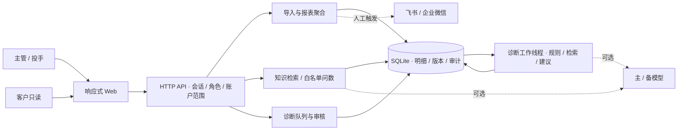

# 架构与设计决策

## 场景与口径

上传聚光或乘风计划报表，按客户和账户查看日报趋势。投手能问数、查 SOP、发起诊断并审核发布。客户只读查看。目标用户以小团队为主，部署形态为单实例与本地数据库。

导入在一次事务内保存明细版本、更新生效日和审计。消耗、成交金额使用整数分存储，CTR 用汇总点击除以汇总曝光，CPC、CPL 分别用汇总消耗除以点击和线索。期间有必需分母缺失时相关指标留空。ROAS 是成交金额除以消耗，按 CSV 的归因窗口解释。

诊断基线为前 7 个日历天中至少 3 个有数据的日期。先检查曝光，再比较 CTR、点击转线索率和点击转订单率。阈值是样例配置，判断结果是优先排查环节。规则输出三条建议，知识库提供证据片段，模型可排序建议。任务把取数和检索结果分别落库。中断后沿已保存的步骤恢复，若中断发生在一次外部请求已发出但还没落 checkpoint，则有再次调用的可能，预留会计入预算。

## ADR 001 · 行级租户隔离

选择共享 SQLite 与显式账户授权。登录态映射到租户和角色，报表和任务入口先校验账户归属，再进入业务函数。主管可以访问本租户全部账户，投手和只读客户需要账户授权。知识库按租户共享，只读客户仅看已发布建议和出处，正文只供内部查看。独立库或独立 schema 能进一步隔离，适用于需独立备份或物理隔离的客户。

## ADR 002 · 规则先于模型

指标、排查环节和查询均由应用决定。模型只返回允许的指标、查询模式和建议排序。服务端从固定查询读取数据，外部返回无法改变租户、日期和权限。基于自由文本直接生成查询或归因能增加表达空间，也会提高对账和审核成本。

## ADR 003 · 单实例和本地数据库

选择标准库 HTTP 服务与 SQLite，便于学习、离线启动和快速验收。数据库保存状态、配额、模型费用和历史版本，方便观察流程。若出现持续并发写、大规模向量检索或高可用需求，可迁移到 FastAPI、Postgres、分析库、向量索引和独立队列。成本看板按租户及账户汇总。无服务方回报时显示预留的保守估算。

访问真实客户数据前，应在 HTTPS 后部署并使用自建账号，按照团队要求管理备份与模型数据授权。服务端限制上传大小、范围、日诊断配额和模型调用预算。公开演示使用合成数据。
